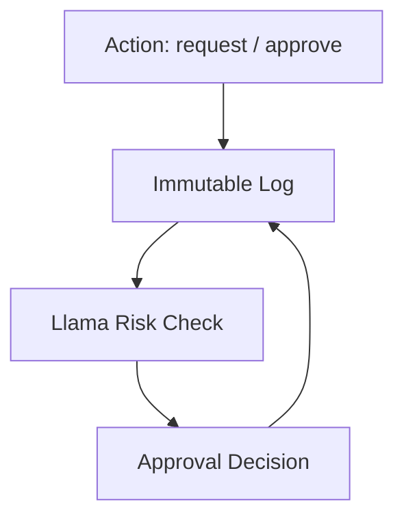

# SHIELD.OS

**Reality OS Integrity Layer** — Meta AI Hackathon submission.

Immutable procurement ledger for MENA workshops. Extracted from Almona Vertical Reality OS (**1,539+ commits**, **200+ workshops in Egypt**), generalized for any industry.

## Problem

**~$2T** is lost to procurement corruption across MENA. Spare-parts requests live in WhatsApp, Excel, and editable DBs. A manager can change *who approved*, *when*, or delete the trail entirely.

## Solution

**SHIELD.OS** seals every action into an append-only, hash-chained ledger:

| Field | Captured |
|---|---|
| Who | actor / `verified_by` |
| Where | workshop + GPS |
| When | `timestamp` |
| What | spare part + payload |
| Approved by | manager decision on-chain |
| Geo | lat/lon |
| Photo hash | SAM evidence fingerprint |

No UPDATE. No DELETE. AI flags risk; humans still approve.

## Architecture

```
Action  →  Log (immutable)  →  Llama Check  →  Approval
```



| Layer | Guarantee |
|---|---|
| App API | PUT / PATCH / DELETE → **405** |
| Postgres trigger | `trg_shield_no_update` raises on UPDATE/DELETE |
| Hash chain | each row links `prev_hash` → `event_hash` |
| RLS | SELECT + INSERT only |

## Meta AI usage

| Tool | Usage |
|---|---|
| **Llama 4 Maverick** | `/lib/llama.ts` — risk_score 0–100 + EN/AR explanation (same approver, 2 AM approvals, geo mismatch, fast approvals) |
| **SAM 3.1** | `/lib/sam.ts` — Meta `sam-3.1` via Responses API; filename mock fallback for Loom demos |
| **Muse Image** | Fake vs real invoice comparison for demo video |
| **Muse Code** | Built with Cursor / Muse Code |

Set `META_API_KEY` from [dev.meta.ai](https://dev.meta.ai) in `.env.local` (and Vercel).  
**Ledger:** production uses Supabase `001_shield_events.sql` (`backend: supabase`). Memory is fallback only.

## Demo

- **App:** https://shield-os-hackathon.vercel.app (Technician / Manager + Arabic RTL)
- **Dashboard:** https://shield-os-hackathon.vercel.app/shield (hash timeline · map · Llama risk)
- **GitHub:** https://github.com/almona02/shield-os-hackathon
- **Video:** *(record Loom — see docs/demo-script.md)*

```bash
git clone https://github.com/almona02/shield-os-hackathon
cd shield-os-hackathon
npm install
cp .env.example .env.local   # fill Supabase + META_API_KEY from dev.meta.ai
npm run dev
```

- **GitHub:** https://github.com/almona02/shield-os-hackathon  
- Without Supabase env vars, the API falls back to an in-memory append-only store.

## How it prevents corruption

1. Technician requests **Motor YLM-45** + photo + geo → sealed as `INSPECTION`.
2. Filename `fake-invoice.png` → SAM path **rejects** (score ~18). Real image URLs hit Meta `sam-3.1`.
3. Manager approve/reject → `VERIFICATION` row; every decision is on-chain.
4. Attacker tries `PUT /api/events` → **405**. DB `UPDATE` → trigger blocks.
5. `/shield` Llama panel: *"2 AM approvals from same manager — High Risk"*.

## Video script (90s)

| Time | Beat |
|---|---|
| 0–20s | `fake-invoice.png` rejected by SAM — “Without Shield, manager edits the log.” |
| 20–50s | Motor YLM-45 request → Manager approve → `PUT /api/events` → **405 Blocked** |
| 50–90s | `/shield` hash chain + map + Llama “2 AM High Risk” → “Built from Almona Vertical Reality OS — now any industry.” |

## Repo layout

```
shield-os-hackathon/
  app/                  Next.js App Router (UI + /api)
  components/           Feed · Technician · Manager · Timeline · Map · Risk
  lib/                  llama.ts · sam.ts · supabase-store.ts
  lib/shield-core/      immutable-log · approval-chain · anomaly-engine
  supabase/migrations/  001_shield_events.sql (trigger + RLS)
  docs/demo-script.md
```

## License

MIT — see [LICENSE](./LICENSE).
