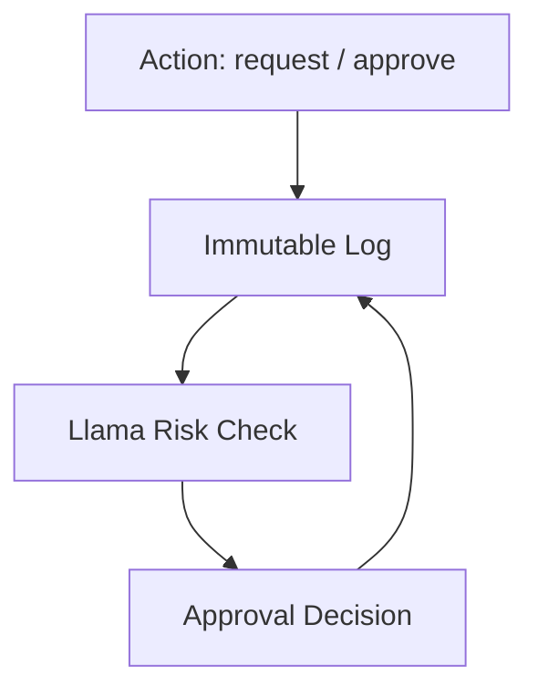

# SHIELD.OS — Immutable Audit Layer for Reality OS

### Meta Global AI Developer Hackathon 2026 Submission

> Who, Where, When, What, Approved By — append-only, hash-chained.

| | |
|---|---|
| **Live Demo** | https://shield-os-hackathon.vercel.app |
| **Dashboard** | https://shield-os-hackathon.vercel.app/shield |
| **Video** | *(paste Loom URL)* |
| **Repo** | https://github.com/almona02/shield-os-hackathon |
| **Source Reality OS** | https://github.com/almona02/almona-portfolio-forge |

---

### Context

Almona Co. is an authorized YILMAZ dealer in Egypt, established 1991, with long-standing market access to aluminium and UPVC workshops.

Over the last year, we built **Almona Vertical Reality OS** — an open workspace that connects machinery discovery, workshop planning, Fabricator Pro (measurement, BOM, cutting optimization), and machine passport/service tickets.

Fabricator Pro itself is technically complete (**1,539 commits**) but is still in pre-deployment / pilot phase. It has not yet been rolled out to production workshops. SHIELD.OS extracts its governance core so it can be validated independently.

### Problem

In workshop operations, approvals for spare parts, service, and procurement are often logged in editable sheets. This allows after-the-fact edits and weakens trust. Traditional GRC systems (SAP GRC, Oracle Risk) are designed for enterprise reporting, not for lightweight, real-time prevention on the shop floor.

### Solution

SHIELD.OS isolates three modules from Reality OS into a minimal, reusable layer:

1. **immutable-log.ts** — from `realityos_core/event_ledger.py` + `chain_verifier.py`
   - Append-only store with hash chain (`prev_hash` → `event_hash`)
   - Postgres: RLS denies UPDATE/DELETE; trigger `shield_block_mutation()` raises on tamper
   - API returns **405** for PUT/PATCH/DELETE

2. **approval-chain.ts** — from `ManufacturingAuthorityResolver.ts` + `vertical_registry.py`
   - Rules: no self-approval, distinct approvers, ordered transitions, frozen state after decision
   - No override path

3. **anomaly-engine.ts** — from `fraud_detector.py` + `anomaly_rule.py`
   - Heuristics: same-approver burst, off-hours, geo mismatch, fast approvals, impossible travel
   - Evidence-only — flags, never silently blocks the append

### Architecture

```
Action → Log (immutable) → Llama Check → Approval
```



### Meta AI Integration

| Tool | Usage | Status |
|------|-------|--------|
| **Llama 4 Maverick** via Meta Model API | `lib/llama.ts` — last 50 events → `{risk_score, findings, explanation_en/ar}` | Live + heuristic fallback |
| **SAM 3.1** | `lib/sam.ts` `verifyEvidence()` — part photo vs fake invoice; image proxied to Meta Responses API | Live (`source: sam_3_1`); filename mock for Loom shortcuts |
| **Muse Image** | Fake vs real invoice assets for demo | Demo packaging |
| **Muse Code** | Extracted core modules from Python/TS originals | Git history |

### Demo

1. **/** Technician: request part (e.g. Motor YLM-45 GENESIS) + evidence + geo → `/api/approvals`
2. Evidence `fake-invoice.png` → reject score ~18 (`mock`)
3. Paste Unsplash/https image URL → accept (`sam_3_1`)
4. Switch to Manager → Approve/Reject → chained `VERIFICATION` event
5. `PUT /api/events` → **405**; `POST /api/tamper` → Postgres trigger blocks
6. **/shield** — hash timeline (`Chain verified`), SVG map, Llama Risk Panel (EN/AR + RTL)

See `docs/demo-script.md` for the 90s Loom teleprompter.

### How to Run

```bash
git clone https://github.com/almona02/shield-os-hackathon
cd shield-os-hackathon
cp .env.example .env.local
# META_API_KEY + NEXT_PUBLIC_SUPABASE_URL + SUPABASE_ANON_KEY
npm install
npm run dev
```

Without Supabase env vars, the API falls back to an in-memory append-only store. **Production uses Supabase** (`001_shield_events.sql`).

### What This Proves

We wanted to validate that the governance layer of Reality OS can stand alone as a general integrity layer for any vertical (workshop, construction, procurement). SHIELD.OS is that validation — small, testable, and deployable separately from the larger OS.

### Next Steps

- Pilot Fabricator Pro + SHIELD in 2–3 workshops in Giza for field data
- Harden SAM prompts per part SKU with workshop photo corpora
- Persist approvals table alongside the immutable ledger

### License

MIT — see [LICENSE](./LICENSE).
